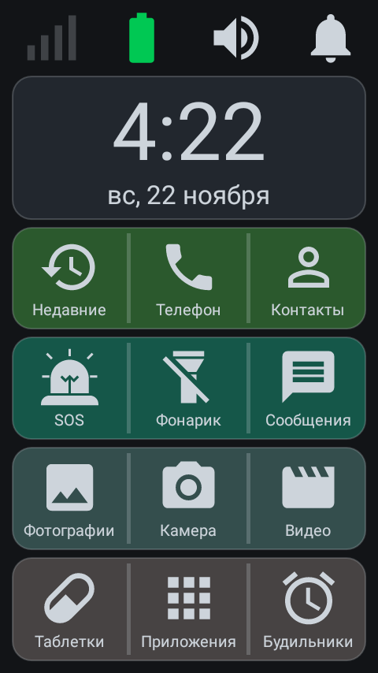
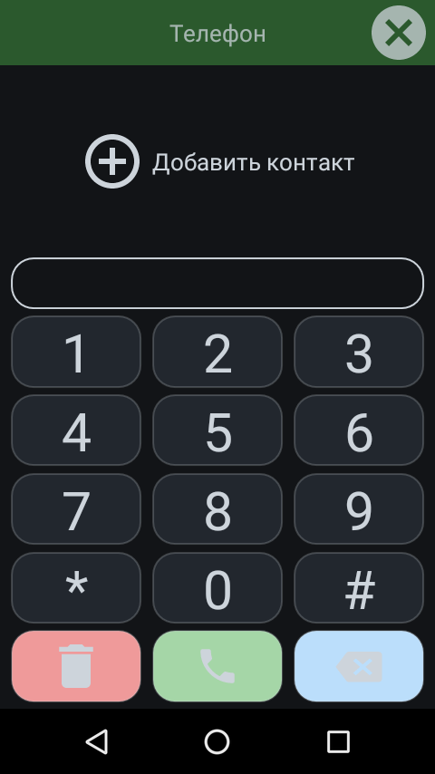
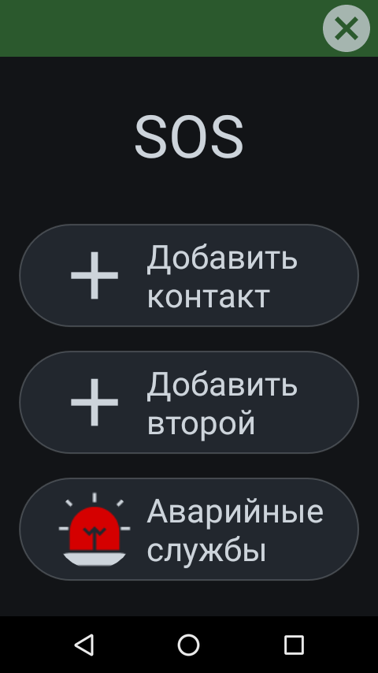

# GranPhone

A simple, offline-first Android launcher + dialer for elderly users — big buttons, minimal distractions, no accounts, no ads, no telemetry.

Forked from [BaldPhone](https://github.com/UriahShaulMandel/BaldPhone) (Apache 2.0) via [vophone](https://github.com/dhqdev/vophone). BaldPhone was pulled from Google Play in 2024 and abandoned upstream; this fork keeps it alive for low-end devices.

<p float="left">
  
  
  
</p>

## What it does

- Replaces the home screen with large tiles: Phone, Contacts, SOS, Messages, Photos, Alarms, Flashlight
- Acts as the default dialer: big-button incoming/outgoing call screen (`InCallService`)
- SOS button with a configurable emergency contact, pill reminders
- Optional kiosk mode (device owner) to lock the phone down to the essentials
- Immersive full screen, dark and light themes, system font scaling
- No ads, no accounts, no telemetry — works fully offline
- Runs on old hardware — developed and tested on Android 6 / 1 GB RAM (`minSdk 21`, `targetSdk 29`)

## Install

See [docs/INSTALL.md](docs/INSTALL.md) — English and Russian.

Short version: install the APK from [Releases](https://github.com/dvinerlove/GranPhone/releases), set GranPhone as the default Home app and default Phone app.

## Build

```
./gradlew assembleFDroidDebug   # JDK 11, Android SDK 31
```

Output: `app/build/outputs/apk/fDroid/debug/app-fDroid-debug.apk`

## License

Apache 2.0 — see [LICENSE](LICENSE). Credits to the original BaldPhone authors.
